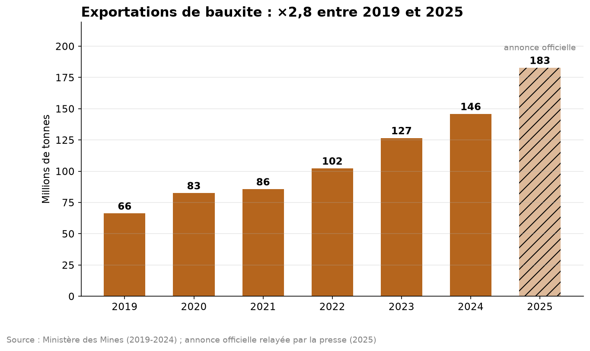
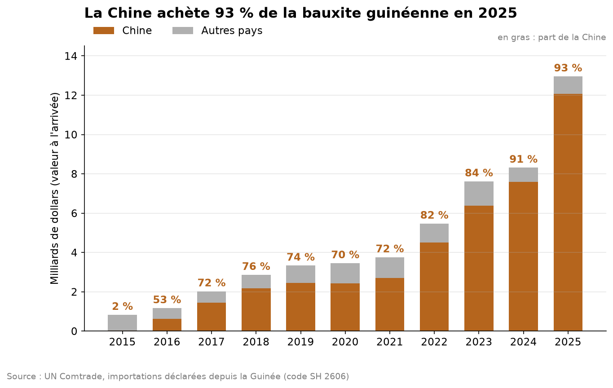
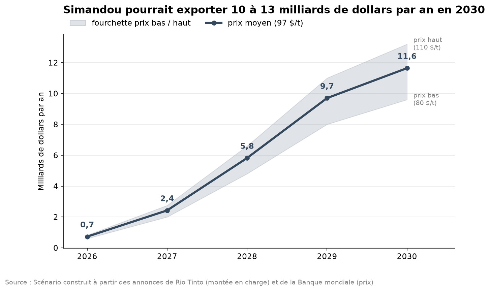
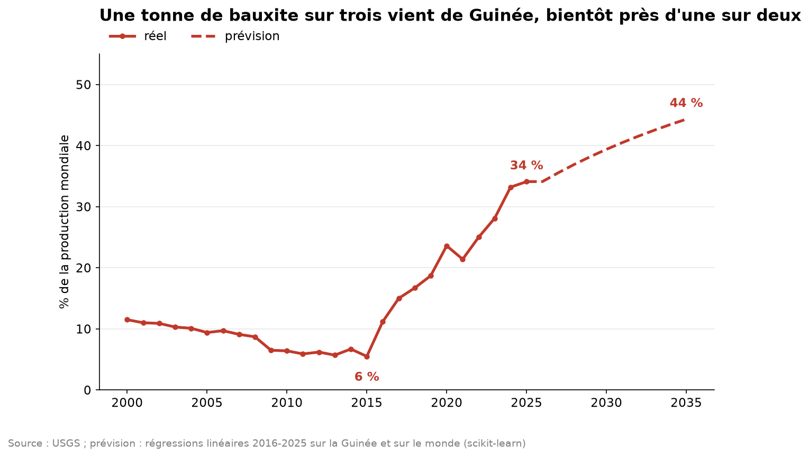
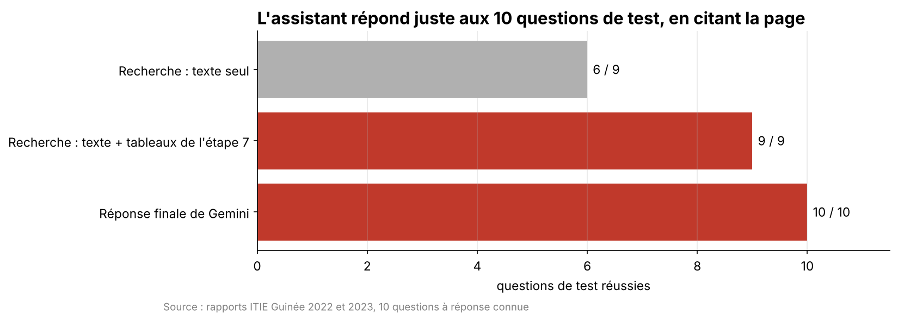

# Guinée Mines Data

**Que représentent les mines pour l'économie guinéenne, qui en profite, et que va changer Simandou ?**

Analyse du secteur minier guinéen (bauxite, or, fer) de 2000 à 2025, prévisions jusqu'en 2035, et un assistant IA qui répond aux questions sur les rapports ITIE en citant ses sources. Données publiques : Banque mondiale, Ministère des Mines et de la Géologie, INS, UN Comtrade, USGS, Rio Tinto, rapports ITIE Guinée.

**Outils :** Python, SQL (DuckDB), pandas, matplotlib, scikit-learn, pdfplumber, API Gemini, Streamlit.

---

## Les résultats en bref

| | Constat | Chiffre clé |
|---|---|---|
| 1 | La Guinée est le pays le plus dépendant des mines de la région | 94 % des exportations en 2024 |
| 2 | Le boom de la bauxite | 66 Mt exportées en 2019, 183 Mt en 2025 (×2,8) |
| 3 | Un secteur concentré | 3 entreprises font 62 % des exportations de bauxite (2024) |
| 4 | L'État touche peu par tonne | environ 9 % de la valeur exportée, 3 $ de taxe minière par tonne |
| 5 | Un client quasi unique | la Chine achète 93 % de la bauxite guinéenne (2 % en 2015) |
| 6 | Simandou, une deuxième bauxite | 10 à 13 Md$ d'exportations par an à plein régime (scénarios) |
| 7 | La Guinée domine la bauxite mondiale | 1er producteur depuis 2023, environ 44 % de la production mondiale en 2035 (prévision) |
| 8 | Simandou démarrera lentement | 6 % de sa capacité la 1re année, contre 25 à 60 % pour des mines comparables |
| 9 | Les paiements à l'État reposent sur deux sociétés | SMB et CBG versent 70 % des paiements miniers en 2023 (ITIE) |
| 10 | Mon modèle d'IA reconnaît le thème des pages ITIE | 93 % de bonnes réponses sur un rapport jamais vu ; 96 % contre 50 % pour Gemini sur les mêmes 26 pages |
| 11 | Un assistant qui cite ses sources | 10 bonnes réponses sur 10 aux questions de test, avec la page du rapport |











---

## Les analyses

| Notebook | Question | Sources |
|---|---|---|
| [01 · Le poids des mines](notebooks/01_poids_des_mines.ipynb) | À quel point l'économie dépend-elle des mines, comparée à ses voisins ? | Banque mondiale, MMG, INS |
| [02 · Entreprises et revenus](notebooks/02_entreprises_et_revenus.ipynb) | Qui exploite la bauxite et l'or, et combien l'État touche-t-il ? | MMG (Annuaire 2023, Bulletin 2024) |
| [03 · Clients et dépendance](notebooks/03_clients_et_dependance.ipynb) | À qui la Guinée vend-elle ses minerais ? | UN Comtrade (données miroir) |
| [04 · Simandou](notebooks/04_simandou.ipynb) | Que pèsera le fer de Simandou à plein régime ? | Rio Tinto, Banque mondiale, Code minier |
| [05 · Prévisions 2035](notebooks/05_previsions_2035.ipynb) | Combien la Guinée produira-t-elle en 2035, et quelle part du monde ? (régression, scikit-learn) | MMG, USGS |
| [06 · Simandou face aux autres mines](notebooks/06_simandou_comparaison.ipynb) | Le scénario de Simandou est-il réaliste ? (prévision par analogie avec Roy Hill et S11D) | Rio Tinto, Fortescue, Vale, USGS |
| [07 · Paiements ITIE](notebooks/07_paiements_itie.ipynb) | Combien chaque société verse-t-elle à l'État, et les chiffres concordent-ils ? (extraction des PDF) | Rapports ITIE 2022 et 2023 |
| [07b · Mon modèle d'IA](notebooks/07b_modele_pages_itie.ipynb) | Un modèle peut-il reconnaître le thème d'une page de rapport ? (TF-IDF, régression logistique) | Rapports ITIE |
| [07c · Le modèle contre Gemini](notebooks/07c_modele_contre_gemini.ipynb) | Un grand modèle de langage fait-il mieux, sur les mêmes pages ? | Rapports ITIE, API Gemini |
| [08 · Assistant RAG](notebooks/08_assistant_rag_itie.ipynb) | Peut-on interroger les rapports en français et obtenir le chiffre avec sa page ? | Rapports ITIE, API Gemini |

Chaque notebook se termine par « Ce qu'il faut retenir » et les limites de l'analyse.

---

## La qualité des données : ce que j'ai trouvé

Une bonne partie du travail a consisté à vérifier les données avant de les utiliser :

- **Rente minière à 0 % en 2019-2021** dans la base de la Banque mondiale, pendant le boom de la bauxite : une donnée manquante enregistrée comme 0. Je l'ai traitée comme manquante.
- **Total 2022 faux de 9 Mt** dans l'Annuaire statistique du ministère : la somme par entreprise et le Bulletin 2024 donnent 103,5 Mt, pas 94,5.
- **Poids estimés dans UN Comtrade :** en 2023, le tonnage chinois est une estimation de l'ONU (13,8 Mt au lieu d'environ 100). J'ai travaillé sur les valeurs en dollars.
- **Déclarations manquantes :** les Émirats n'ont pas déclaré leurs achats d'or de 2024-2025 ; la « chute » de l'or ces années-là n'est pas réelle.
- **Écart de valeur :** les pays acheteurs déclarent environ deux fois plus de valeur que l'INS pour la bauxite de 2024 ; le transport n'explique pas tout.

---

## Organisation du projet

```
data/        les données (CSV), chaque chiffre recopié à la main indique sa source et sa page
sql/         les requêtes SQL, une par fichier (01_ à 07_ selon l'analyse)
src/         le code Python réutilisable
  requetes.py                     lance une requête de sql/ avec ses paramètres
  graphiques.py                   tous les graphiques du projet
  telecharger_banque_mondiale.py  télécharge les données de l'API Banque mondiale
  telecharger_comtrade.py         télécharge les données miroir UN Comtrade
  prevision.py                    régressions et intervalles de prédiction (étape 5)
  telecharger_itie.py, itie.py, extraire_itie.py   téléchargement et lecture des rapports ITIE (PDF)
  pages_itie.py, preparer_pages_itie.py, classifieur_pages.py   mon modèle qui classe les pages (étape 7b)
  gemini_pages.py                 les mêmes pages classées par Gemini (étape 7c)
  rag_itie.py                     l'assistant RAG : recherche des passages, puis réponse de Gemini
  evaluer_rag.py                  pose les 10 questions de test à l'assistant
  assistant_itie.py               l'assistant dans le terminal
  app_assistant.py                l'assistant dans une page web (Streamlit)
notebooks/   les analyses : appels aux requêtes, résultats, graphiques, conclusions
images/      les graphiques exportés
```

Choix techniques :
- **DuckDB** pour écrire du SQL directement sur les fichiers CSV, sans serveur de base de données.
- **Le SQL est séparé du Python** (`sql/*.sql`) : chaque requête est lisible et testable seule.
- **Les faits sont séparés des hypothèses** pour Simandou (`simandou.csv` et `hypotheses_simandou.csv`) : on peut changer un scénario sans toucher au code.
- **Chaque modèle est testé sur des données qu'il n'a pas vues** : prévisions testées sur 2022-2024, classifieur entraîné sur le rapport 2022 et testé sur 2023, assistant évalué sur 10 questions à réponse connue.
- **Un petit modèle local d'abord, un grand modèle ensuite** : TF-IDF trouve les bons passages sur le PC, Gemini ne reçoit que ces passages. Chaque réponse est vérifiable (page citée).

Notions SQL utilisées : agrégations, `CASE WHEN`, `NULLIF`, CTE (`WITH`), pivot avec `FILTER`, jointures, `CROSS JOIN`, `UNION ALL`, fonctions de fenêtre (`OVER`, `PARTITION BY`, `ROW_NUMBER`, `QUALIFY`).

---

## Reproduire l'analyse

Python 3.13.

```
pip install -r requirements.txt
py src\telecharger_banque_mondiale.py
py src\telecharger_comtrade.py
```

Puis ouvrir les notebooks dans l'ordre et tout exécuter. Les autres fichiers de `data/` ont été construits à la main à partir des rapports officiels (source et page dans chaque ligne).

Pour les étapes 7 et 8 (rapports ITIE) :

```
py src\telecharger_itie.py
py src\preparer_pages_itie.py
```

L'API Gemini demande une clé gratuite (Google AI Studio), à mettre dans un fichier `.env` à la racine : `GEMINI_API_KEY=...`. Ce fichier n'est jamais publié.

Lancer l'assistant dans le navigateur :

```
py -m streamlit run src\app_assistant.py
```

---

## Suite du projet

- **Tableau de bord Power BI** qui rassemble les résultats du projet.
- **Recherche par le sens** (*embeddings*) pour l'assistant, et d'autres tableaux des rapports ITIE transformés en fiches.
