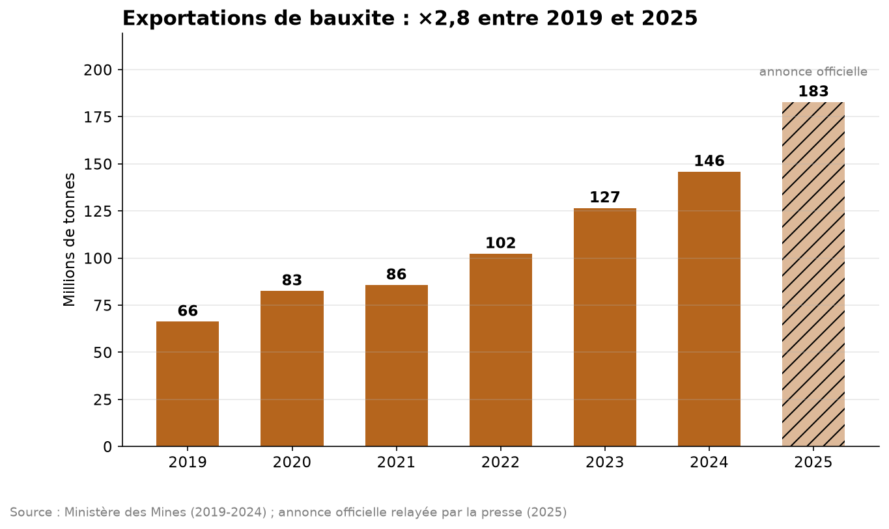
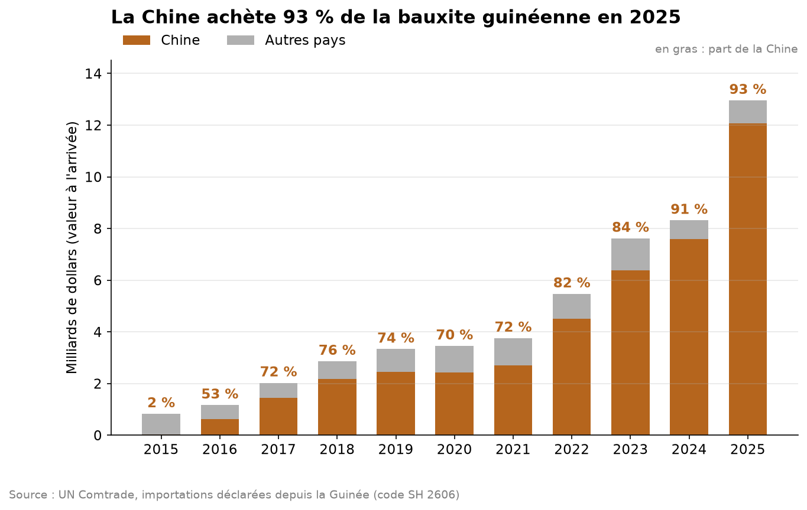
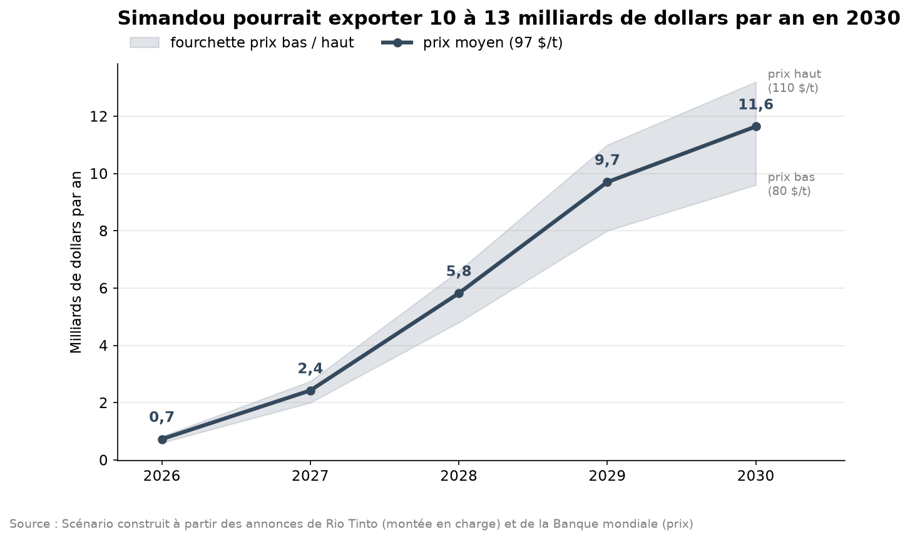

# Guinée Mines Data

**Que représentent les mines pour l'économie guinéenne, qui en profite, et que va changer Simandou ?**

Analyse du secteur minier guinéen (bauxite, or, fer) de 2000 à 2025, à partir de données publiques : Banque mondiale, Ministère des Mines et de la Géologie, INS, UN Comtrade, Rio Tinto. Python, SQL (DuckDB), pandas, matplotlib.

---

## Les résultats en bref

| | Constat | Chiffre clé |
|---|---|---|
| 1 | La Guinée est le pays le plus dépendant des mines de la région | 94 % des exportations en 2024 |
| 2 | Le boom de la bauxite | 66 Mt exportées en 2019, 183 Mt en 2025 (×2,8) |
| 3 | Un secteur concentré | 3 entreprises font 62 % des exportations de bauxite (2024) |
| 4 | L'État touche peu par tonne | environ 9 % de la valeur exportée, 3 $ de taxe minière par tonne |
| 5 | Un client quasi unique | la Chine achète 93 % de la bauxite guinéenne (2 % en 2015) |
| 6 | Simandou, une deuxième bauxite | 10 à 13 Md$ d'exportations par an à plein régime (scénarios) |







---

## Les quatre analyses

| Notebook | Question | Sources |
|---|---|---|
| [01 · Le poids des mines](notebooks/01_poids_des_mines.ipynb) | À quel point l'économie dépend-elle des mines, comparée à ses voisins ? | Banque mondiale, MMG, INS |
| [02 · Entreprises et revenus](notebooks/02_entreprises_et_revenus.ipynb) | Qui exploite la bauxite et l'or, et combien l'État touche-t-il ? | MMG (Annuaire 2023, Bulletin 2024) |
| [03 · Clients et dépendance](notebooks/03_clients_et_dependance.ipynb) | À qui la Guinée vend-elle ses minerais ? | UN Comtrade (données miroir) |
| [04 · Simandou](notebooks/04_simandou.ipynb) | Que pèsera le fer de Simandou à plein régime ? | Rio Tinto, Banque mondiale, Code minier |

Chaque notebook se termine par « Ce qu'il faut retenir » et les limites de l'analyse.

---

## La qualité des données : ce que j'ai trouvé

Une bonne partie du travail a consisté à vérifier les données avant de les utiliser :

- **Rente minière à 0 % en 2019-2021** dans la base de la Banque mondiale, pendant le boom de la bauxite : une donnée manquante enregistrée comme 0. Je l'ai traitée comme manquante.
- **Total 2022 faux de 9 Mt** dans l'Annuaire statistique du ministère : la somme par entreprise et le Bulletin 2024 donnent 103,5 Mt, pas 94,5.
- **Poids estimés dans UN Comtrade :** en 2023, le tonnage chinois est une estimation de l'ONU (13,8 Mt au lieu d'environ 100). J'ai travaillé sur les valeurs en dollars.
- **Déclarations manquantes :** les Émirats n'ont pas déclaré leurs achats d'or de 2024-2025 ; la « chute » de l'or ces années-là n'est pas réelle.
- **Écart de valeur :** les pays acheteurs déclarent environ deux fois plus de valeur que l'INS pour la bauxite de 2024 ; le transport n'explique pas tout.

---

## Organisation du projet

```
data/        les données (CSV), chaque chiffre recopié à la main indique sa source et sa page
sql/         les requêtes SQL, une par fichier (01_ à 04_ selon l'analyse)
src/         le code Python réutilisable
  requetes.py                     lance une requête de sql/ avec ses paramètres
  graphiques.py                   tous les graphiques du projet
  telecharger_banque_mondiale.py  télécharge les données de l'API Banque mondiale
  telecharger_comtrade.py         télécharge les données miroir UN Comtrade
notebooks/   les analyses : appels aux requêtes, résultats, graphiques, conclusions
images/      les graphiques exportés
```

Choix techniques :
- **DuckDB** pour écrire du SQL directement sur les fichiers CSV, sans serveur de base de données.
- **Le SQL est séparé du Python** (`sql/*.sql`) : chaque requête est lisible et testable seule.
- **Les faits sont séparés des hypothèses** pour Simandou (`simandou.csv` et `hypotheses_simandou.csv`) : on peut changer un scénario sans toucher au code.

Notions SQL utilisées : agrégations, `CASE WHEN`, `NULLIF`, CTE (`WITH`), pivot avec `FILTER`, jointures, `CROSS JOIN`, `UNION ALL`, fonctions de fenêtre (`OVER`, `PARTITION BY`, `ROW_NUMBER`, `QUALIFY`).

---

## Reproduire l'analyse

Python 3.13.

```
pip install -r requirements.txt
py src\telecharger_banque_mondiale.py
py src\telecharger_comtrade.py
```

Puis ouvrir les notebooks dans l'ordre et tout exécuter. Les autres fichiers de `data/` ont été construits à la main à partir des rapports officiels (source et page dans chaque ligne).

---

## Suite du projet

- **Prévision** de la production de bauxite jusqu'en 2050 (régression, avec l'incertitude chiffrée).
- **Extraction automatique** des tableaux des rapports ITIE (PDF) avec un modèle de langage.
- **Un assistant** qui répond aux questions sur les rapports miniers guinéens en citant ses sources.
